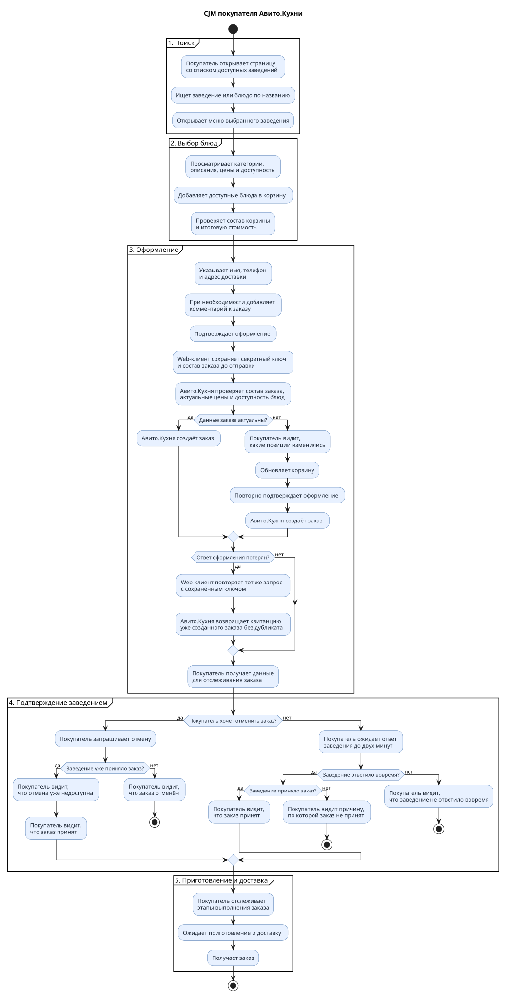
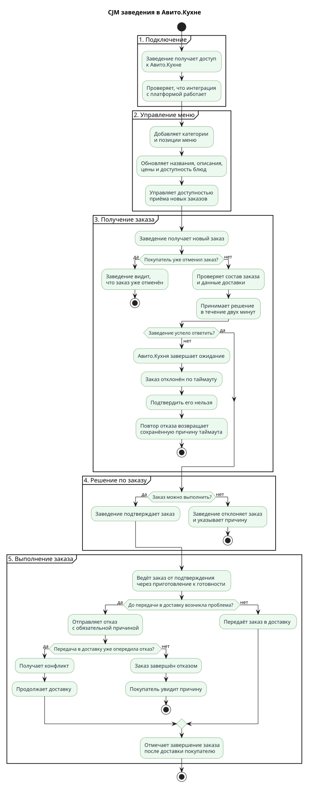
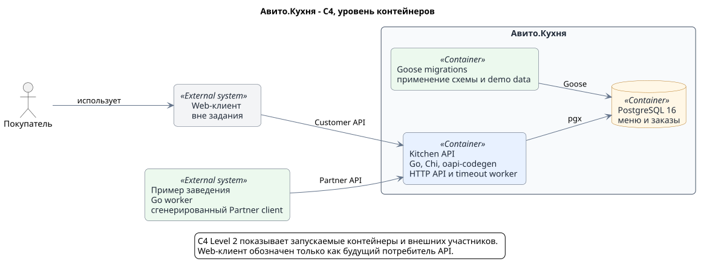
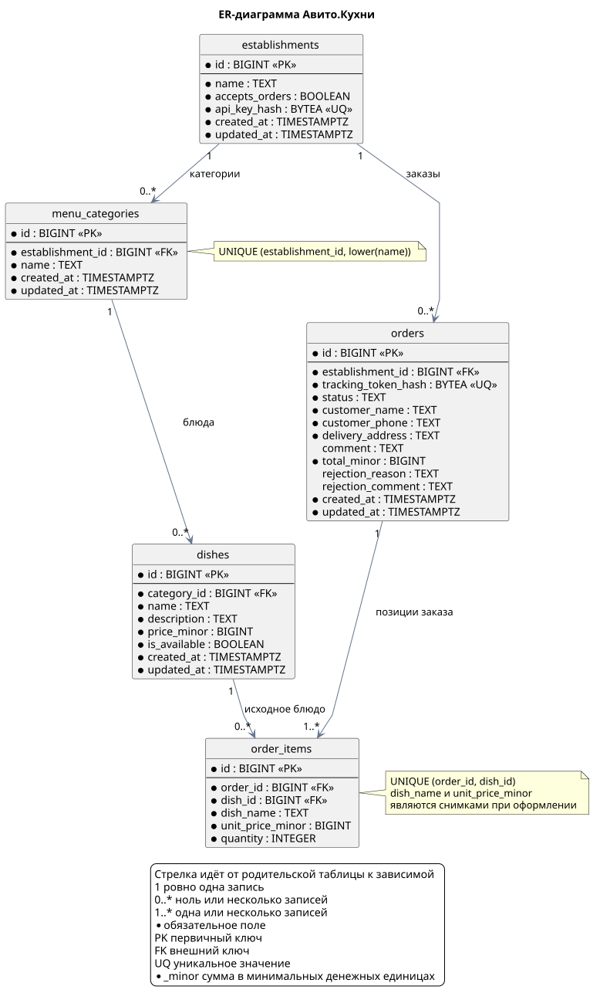

# Авито.Кухня

MVP backend-сервиса, через который покупатель может выбрать блюда и оформить доставку без регистрации, а заведение может управлять меню и выполнять полученные заказы.

В репозитории находятся основной API-сервис, отдельный пример интеграции заведения, PostgreSQL, миграции Goose, OpenAPI-контракт и Docker Compose для общего запуска.

## Что реализовано

- поиск заведений по названию заведения или блюда;
- просмотр меню с категориями, ценами и доступностью;
- оформление, отслеживание и отмена заказа без аккаунта;
- проверка изменившейся цены и наличия перед созданием заказа;
- закрытый API заведения для меню, приёма заказов и изменения статусов;
- автоматическое отклонение заказа, если заведение не ответило за две минуты;
- отдельный сервис заведения, который проходит успешный lifecycle заказа;
- защита конкурентных изменений заказов и меню;
- сквозные E2E-сценарии через настоящий HTTP API и PostgreSQL.

## Как я проектировал

Я начал не с кода, а с разборки задания и границ MVP. Сначала описал шесть бизнес-сценариев: успешный заказ, изменение цены или доступности, отклонение заведением, timeout подтверждения, отмена покупателем и обновление меню.

По этим сценариям составил две CJM, чтобы отдельно пройти путь покупателя и путь заведения. Затем определил пять сущностей: заведение, категория меню, блюдо, заказ и позиция заказа.

После сущностей спроектировал связи, ограничения, индексы и транзакции PostgreSQL. Следующим шагом зафиксировал OpenAPI: сначала покупательские методы, затем закрытые партнёрские методы и общие модели ошибок.

Когда контракт стал понятен, выбрал архитектуру Go-кода `handlers -> service -> repository`, вынес чистые модели и правила в `domain`, а транспортные DTO и интерфейсы сервера сгенерировал через oapi-codegen. После основного сервиса добавил отдельный сервис заведения, Docker Compose, линтер и E2E.

В конце код прошёл несколько циклов независимого review. По найденным замечаниям были исправлены конкурентные `PATCH` блюд, согласованность чтения меню, лимиты запросов, миграция demo data и изоляция E2E-окружения.

## Основные вопросы и решения

| Вопрос | Решение для MVP |
|---|---|
| Как отслеживать заказ без авторизации? | После создания вернуть случайный `tracking_token`, а в БД хранить только его SHA-256 хеш. |
| Что делать, если цена или наличие изменились? | Не создавать заказ, вернуть `409 Conflict` и актуальные данные изменившихся позиций. |
| Где хранить корзину? | На стороне web-клиента. Сервер получает только итоговый состав и заново проверяет его. |
| Что делать, если заведение не ответило? | Через две минуты автоматически перевести заказ в `rejected` с причиной `confirmation_timeout`. |
| Как защититься от гонки подтверждения, отмены и timeout? | Менять статус условным SQL `UPDATE`. Успешно завершается только первый допустимый переход. |
| Где проверять данные? | Понятные бизнес-ошибки формирует Go-код, а PostgreSQL защищает критическую целостность constraints и внешними ключами. |
| Как считать деньги? | Хранить значения целыми числами в минимальных денежных единицах, без `FLOAT`. |
| Кто отвечает за доставку и оплату? | Само заведение. Авито.Кухня хранит стоимость и статусы, но не управляет курьерами и платежами. |

## CJM

Диаграммы собраны из бизнес-сценариев и сгенерированы из PlantUML.

### Покупатель



[Исходник PlantUML](docs/diagrams/customer-cjm.puml)

### Заведение



[Исходник PlantUML](docs/diagrams/establishment-cjm.puml)

## Архитектура



[Исходник PlantUML](docs/diagrams/c4-containers.puml)

`Kitchen API` содержит HTTP-сервер и timeout worker. Основной поток запроса проходит через handlers, service и repository к PostgreSQL. `domain` не зависит от HTTP, pgx и сгенерированных моделей.

OpenAPI является источником контракта. Из него генерируются типы и strict server основного сервиса, а также Partner client, которым пользуется пример заведения.

## Схема БД



[Исходник PlantUML](docs/diagrams/database-erd.puml) | [SQL-миграции](migrations)

В PostgreSQL пять основных таблиц: `establishments`, `menu_categories`, `dishes`, `orders` и `order_items`. Позиция заказа хранит снимок названия и цены блюда, поэтому последующее изменение меню не меняет уже созданный заказ.

Создание заказа и его позиций выполняется одной транзакцией. Конкурирующие переходы статуса защищены условным `UPDATE`, а меню читается из согласованного `REPEATABLE READ` snapshot.

## API

Полный контракт находится в [api/openapi.yaml](api/openapi.yaml).

| API | Возможности |
|---|---|
| Customer | список и поиск заведений, меню, создание заказа, статус и отмена по tracking token |
| Partner | управление категориями, блюдами и приёмом заказов, получение заказов и изменение статусов |

Покупательские методы не требуют аккаунта. Получение и отмена заказа защищены tracking token. Партнёрские методы используют `Authorization: Bearer <api-key>` и доступны только данным своего заведения.

## Запуск

```bash
docker-compose up --build
```

API будет доступен на `http://localhost:8080`. Миграции применяются автоматически. Вместе с сервисом запускается demo-заведение с API-ключом `demo-partner-key`, двумя категориями и тремя блюдами.

Остановка:

```bash
docker-compose down
```

Если используется Compose v2, команды можно запускать как `docker compose ...`.

## Проверки

```bash
make test
make test-race
make lint
make test-e2e
```

`make test-e2e` поднимает отдельное временное Compose-окружение без worker-а заведения, проверяет реальные HTTP-сценарии и удаляет только свои контейнеры и volume.

Для повторной генерации серверных типов и клиента:

```bash
go generate ./...
```

## Упрощения MVP

- покупатели считаются гостями, связь заказа с аккаунтом Авито не хранится;
- один заказ содержит блюда только одного заведения;
- меню небольшое и возвращается целиком без пагинации;
- уведомления работают через polling, без WebSocket, SMS и push;
- изображения, платежи, курьеры, удаление данных и история статусов не реализованы;
- повторный `POST` после потерянного ответа может создать второй заказ, idempotency key оставлен как развитие;
- монетизация не входит в MVP. Возможное развитие: агрегировать суммы завершённых заказов и рассчитывать процент комиссии заведения.

## Стек

Go 1.25, Chi, pgx, PostgreSQL 16, Goose, oapi-codegen, OpenAPI 3.0, Docker Compose, GolangCI-Lint и PlantUML.

ИИ использовался как инструмент для обсуждения решений, реализации и review. Все изменения отдельно проверялись тестами, race detector, линтером, миграциями и повторным review кода.
В реализации я использовал кастомных агентов со скилами.
